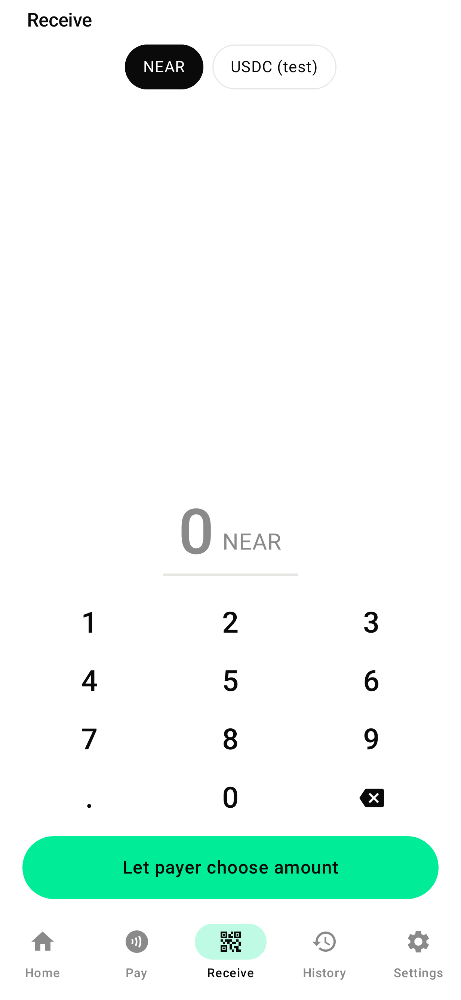
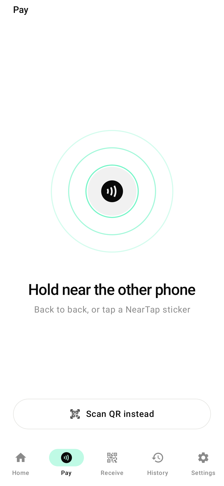
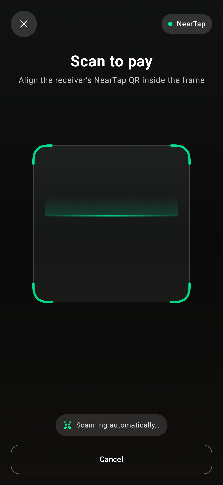
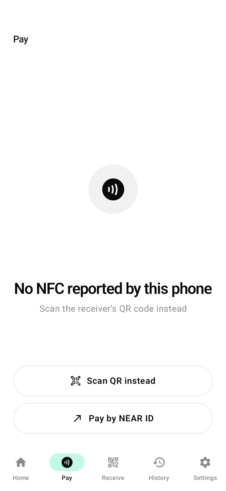
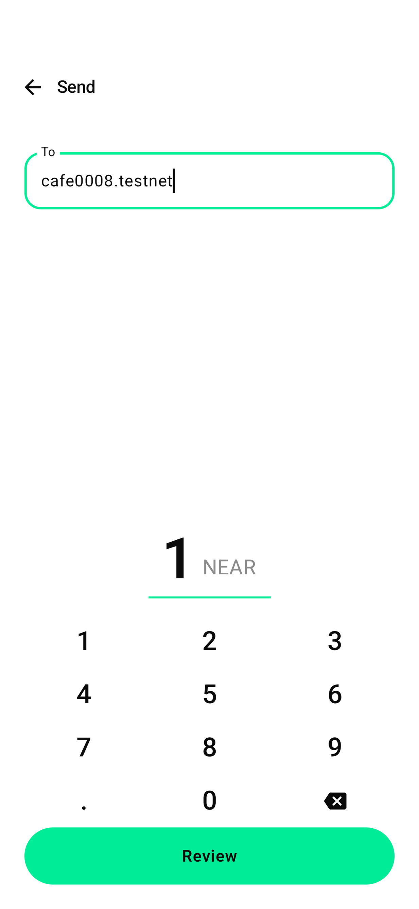
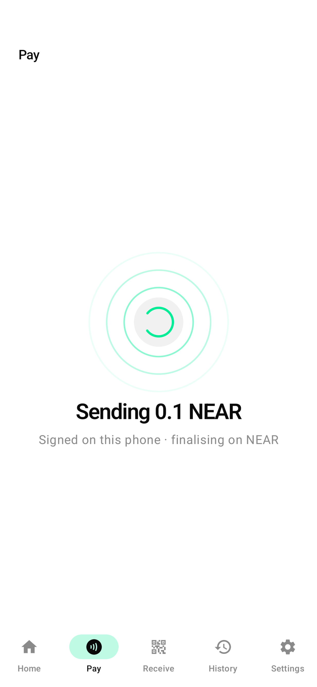

# NearTap

**Tap, scan or type a NEAR ID — and get paid in NEAR in seconds, phone to phone.**

Live site: **https://nearappweb.vercel.app** · Android APK: [`downloads/neartap.apk`](https://nearappweb.vercel.app/downloads/neartap.apk)

▶️ Demo video: **TODO — add link** <!-- replace with the YouTube / Loom URL before submitting -->

Hackathon tracks: **08 · Real-World Money** and **13 · Open Innovation**

---

## The problem

Paying someone in crypto in person is still painful: copy a long address, pick a network, guess the
amount, wait, then screenshot a hash as "proof". Nobody does that at a café counter or a market stall.
NearTap makes an on-chain NEAR payment feel like a contactless card payment: the receiver types an
amount, the payer taps, scans, or picks a NEAR ID, confirms once, and both phones show **PAID** when
the transaction is final on NEAR.

## Three ways to pay

| | How | Works on |
|---|---|---|
| **Tap (NFC)** | Receiver's phone acts as a card (Android HCE). Payer holds phones back to back. | Android phones with NFC |
| **QR** | Receiver shows a QR (`neartap:pay?to=…&amount=…`); payer scans it in NearTap. | Any Android phone with a camera |
| **NEAR ID** | Payer opens **Pay → Pay by NEAR ID** (or Home → Send), types `cafe.testnet` and an amount. | Any Android phone |

On phones without NFC the Pay tab opens straight into the scanner; *Pay by NEAR ID* is one tap away.

## How it works

1. **Receive** – the receiver types an amount. NearTap creates a payment request
   (account, amount in yocto, nonce, ~5 min expiry) and offers it over NFC (HCE, AID `F048414C4F504159`)
   and as a QR code at the same time.
2. **Pay** – the payer's phone reads the request (NFC tap or QR), or the payer types a NEAR ID, and shows
   a confirm screen with the receiver, amount and expiry.
3. **Sign on the phone** – the account key never leaves the device: it is stored encrypted with the
   Android Keystore and gated by the screen lock (fingerprint / face / PIN). The transaction is signed
   locally and sent to **NEAR testnet** RPC.
4. **Optional gasless relayer** – set a relayer URL in Settings and the payer signs a NEP-366 delegate
   action instead; the relayer pays the gas. Without one, the payer pays a tiny NEAR fee.
5. **Optional session contract** – a small `near-sdk` contract adds one-time nonces, expiry checks and
   `payment` events. Plain transfers work without it.
6. **Done** – both phones watch the chain and show **PAID / RECEIVED** with a NearBlocks link.

## Try it

1. Download [`neartap.apk`](https://nearappweb.vercel.app/downloads/neartap.apk) on an Android 10+ phone
   (arm64), allow "install unknown apps" for your browser, and install.
2. **Updating from 1.3.0?** 1.3.1+ is signed with a new key, so Android won't update in place:
   back up your account key in Settings, **uninstall the old app first**, then install.
3. Create or import a testnet account, fund it at the [testnet faucet](https://near-faucet.io/),
   and set a screen lock.
4. On a second phone, open **Receive**, type an amount and let the first phone tap, scan or send by NEAR ID.

Current release: **1.3.2-hackathon** (version, size and SHA-256 are listed on the live site).

## Tech stack

- **Android app** – Kotlin, Jetpack Compose, Android HCE + NFC reader mode, CameraX + ML Kit barcode
  scanning, Android Keystore + BiometricPrompt.
- **NEAR** – testnet JSON-RPC, ed25519 signing on device, NEP-366 meta-transactions for the optional
  relayer, optional Rust `near-sdk` session contract.
- **Site** – static HTML/CSS/JS on Vercel (`index.html`, `assets/`, `downloads/`, `.well-known/assetlinks.json`).

## Honest limitations

- **Android only.** iOS doesn't let third-party apps emulate a card, so phone-to-phone tap can't run on iPhone.
- **NEAR testnet only**, native NEAR only. No mainnet funds.
- **Signing key changed in 1.3.1** – existing 1.3.0 installs must uninstall first (see above).
- **NEAR ID payments send on "Review"** – there is no extra confirm screen in the Send flow yet.
- **Gasless needs a relayer you run**; without it the payer pays the (tiny) gas.
- Tap payments need both phones to have NFC turned on; QR and NEAR ID work everywhere.

## Where the source lives

- This repo: the landing site, the release APK in `downloads/`, and `android-patch/` – the patch
  (`ScanFix.java`, `apply.py`, `build.sh`) applied to the 1.3.0 build to produce 1.3.1/1.3.2
  (scanner on Pay, Pay by NEAR ID, `neartap:` QRs, NEAR-only Receive).
- The original Android Studio project for the app is not in this repo yet.
- Internal identifiers from the early "Halo" prototype are kept for compatibility
  (app ID `com.halopay.near`, NFC AID); old `halopay:` QR codes still scan.

Release helper: `scripts/update-apk.sh path/to/neartap.apk <version>` copies the APK into `downloads/`
(as `neartap.apk`, plus `halo.apk` for old links) and updates the version, size and SHA-256 on the site.
